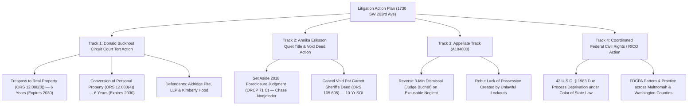

# STRATEGIC ACTION PLAN & LITIGATION ROADMAP
## Subject Property: 1730 SW 203rd Ave, Beaverton, OR 97003
**Prepared for:** Annika Eriksson, Donald Buckhout, Retained Counsel, & Litigation Partners
**Key Dates & Statutes:** ORS 12.080 (6-Year Torts); ORS 12.040 (10-Year Quiet Title); ORCP 71 C (Void Judgment)
**Target Defendants:** Aldridge Pite, LLP; Kimberly Hood; Deutsche Bank Trust Company Americas; PHH Mortgage / NewRez

================================================================================
### SECTION I. THE STRATEGIC ROADMAP OVERVIEW
================================================================================

The dismissal of Donald Buckhout's small claims case (`24SC05266`) for lack of service and the 3-minute dismissal of Annika Eriksson's quiet title case (`23CV50085`) do **NOT** bar recovery. 

Under Oregon law, a dismissal for want of prosecution / failure to serve is **without prejudice** (ORCP 54 B(4)). Aldridge Pite, LLP and Kimberly Hood are not protected by landlord-tenant limitations because they were third-party tortfeasors.

================================================================================
### SECTION II. TRACK 1: DONALD BUCKHOUT CIRCUIT COURT TORT ACTION
================================================================================

* **Jurisdiction / Forum:** Washington County Circuit Court (General Civil Jurisdiction; not Small Claims).
* **Parties:** Donald Buckhout, Plaintiff v. Aldridge Pite, LLP; Kimberly Hood; and John Doe Locksmith / Property Preservation Company, Defendants.
* **Governing Statutes of Limitations:**
  * **Trespass to Real Property (ORS 12.080(3)):** 6 Years &bull; **Timely until February 2030.**
  * **Conversion of Personal Property (ORS 12.080(4)):** 6 Years &bull; **Timely until February 2030.**
* **Core Causes of Action:**
  1. **Common Law Trespass to Land:**
     * Elements: Lawful peaceable possession of real property; intentional, unauthorized physical entry by defendants.
     * Proof: Donald resided at 1730 SW 203rd Ave as a bona fide tenant. Defendants had no writ of assistance, no judgment of eviction, and entered to seize control without judicial authority.
  2. **Conversion of Personal Property:**
     * Elements: Wrongful exercise of dominion or control over plaintiff's chattels in denial of plaintiff's rights.
     * Proof: Defendants changed locks, locking Don out of his household furnishings, clothes, tools, electronics, and documents, refusing access and causing total deprivation.
  3. **Consequential & Punitive Damages:**
     * Consequential damages for emergency displacement, hotel/temporary housing expenses, and lost work opportunities.
     * Punitive damages for wanton, deliberate disregard of civil rights under Oregon law (*Noe v. Kaiser Foundation Hospitals*, 248 Or 420).
* **Strategic Advantage over Small Claims:**
  * Avoids the $10,000 small claims statutory damages ceiling.
  * Overcomes the 1-year Landlord-Tenant Act limitation (ORS 12.125) because Aldridge Pite and Kimberly Hood were third-party intermeddlers, not landlords.
  * Allows formal discovery, interrogatories, and deposition of Kimberly Hood regarding who authorized the lockouts.

================================================================================
### SECTION III. TRACK 2: ANNIKA ERIKSSON QUIET TITLE & VOID DEED ACTION
================================================================================

* **Jurisdiction / Forum:** Washington County Circuit Court / Oregon Court of Appeals.
* **Parties:** Annika Eriksson, Plaintiff v. Deutsche Bank Trust Company Americas as Trustee for RALI 2006-QS14, Defendant.
* **Governing Limitation Periods:**
  * **Recovery of Real Property (ORS 12.040(1)):** 10 Years &bull; **Timely until December 19, 2033.**
  * **Determination of Adverse Claims (ORS 105.605):** Governed by 10-year limitation.
  * **Attack on Void Judgment (ORCP 71 C):** **NO STATUTE OF LIMITATIONS (Perpetually Actionable).**
* **The Two Pillars of Title Nullity:**
  1. **Void Rescission for Nonjoinder of JPMorgan Chase Bank:**
     * In `18CV01284`, Deutsche Bank sought to rescind Chase's 2014 recorded Deed of Reconveyance without joining Chase as a defendant.
     * Under *Hughes v. Aetna Cas. & Sur. Co.*, 234 Or 426, 434 (1963), an adjudication that purports to extinguish the legal rights of an omitted indispensable party is void *ab initio*.
     * Because the rescission was void, the 2014 reconveyance remains valid and intact of record, extinguishing the 2006 Deed of Trust before Turning Leaf Homes and Annika acquired title!
  2. **Facial Invalidity of the "Pat Garrett" Sheriff's Deed:**
     * The Sheriff's Deed recorded December 19, 2023 (Instrument No. 2023-066922) names *"Pat Garrett, Sheriff of Washington County, Oregon"* as grantor.
     * Sheriff Pat Garrett had retired prior to execution.
     * An instrument executed in the name of a private citizen who no longer holds constitutional authority cannot pass title. The deed is null, leaving legal title vested in Annika Eriksson under Deed No. 2021-130007.

================================================================================
### SECTION IV. TRACK 3: APPELLATE PROSECUTION (`A184800`)
================================================================================

* **Current Posture:** Notice of Appeal filed July 5, 2024; late service clarified under Pioneer excusable neglect standards on October 31 & November 29, 2024; record uploaded to Court of Appeals.
* **Assignments of Error to Brief:**
  1. **Abuse of Discretion under ORCP 71 B(1):** Judge Erik Buchér abused his discretion by dismissing with prejudice after a 3-minute hearing when Annika was prevented from attending due to a transportation failure (Casey Conant oversleeping) and acute medical hospitalization (Kaiser Sunnyside, severe kidney infection with sepsis).
  2. **Equitable Estoppel Bars Lack-of-Possession Defense:** Deutsche Bank moved to dismiss on the sole ground that Annika was not in possession, but Deutsche Bank’s own agents (Aldridge Pite / Kimberly Hood) created that lack of possession through unlawful lockouts in direct violation of a recorded lis pendens! Under *Bennett v. City of Salem*, 192 Or 531, a party cannot profit from a condition created by its own wrongful acts.
  3. **Ultra Vires Dismissal With Prejudice on Rule 21 Pleading Motion:** Under ORCP 21 A and ORCP 25 A, dismissal without leave to replead is reversible error where viable claims of voidness and title defects exist.

================================================================================
### SECTION V. TRACK 4: COORDINATED FEDERAL CIVIL RIGHTS ACTION (42 U.S.C. § 1983)
================================================================================

* **Pattern & Practice Alignment:**
  * In Multnomah County (Janice Dysinger): Foreclosure mills deploy manufactured allonges, midnight assignments, unauthorized UTCR 5.100 signature blocks, and extortionate bond demands to choke off hearings.
  * In Washington County (Annika Eriksson & Don Buckhout): Foreclosure mills deploy extra-judicial lockouts without eviction judgments, take advantage of 15-week sheriff delays, and exploit retired sheriff deeds to seize real estate.
  * In Clackamas County (Chapin Court): City officials and servicers deploy utility shutoffs, backhoe barriers, and dark-drawer liens to coerce property abandonment.
* **Federal Due Process Claims:** Joining these practices under 42 U.S.C. § 1983 and the Fair Debt Collection Practices Act (FDCPA) establishes a systemic conspiracy to deprive Oregon homeowners and tenants of their property without due process of law.

================================================================================
*Action plan finalized for legal team execution and client briefing.*
