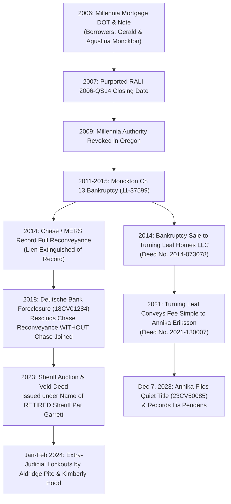

# FORENSIC TITLE & FORECLOSURE NULLITY AUDIT
## Subject Property: 1730 SW 203rd Ave, Beaverton, OR 97003
**Tax Parcel / Legal ID:** Lot 10, Shadow Wood No. 2, Washington County, Oregon
**Audited Period:** 2006 – 2026
**Record Title Owner:** Annika Eriksson (Deed Recorded Dec 20, 2021 as Document No. 2021-130007)

================================================================================
### SECTION I. CHAIN OF CONVEYANCES & RECORD TIMELINE
================================================================================

The title history of 1730 SW 203rd Ave reveals a classic, multi-phase securitization failure, culminating in the fraudulent omission of indispensable parties and an ultra vires Sheriff’s Deed executed in the name of a retired official:

***
#### 1. The Originating Loan & Securitization Defects (2006–2009)
* **Execution:** On or about June 2006, Gerald G. Monckton Jr. and Agustina L. Monckton executed a promissory note and Deed of Trust securing real property at 1730 SW 203rd Ave, Beaverton, OR in favor of **Millennia Mortgage Corporation**, naming MERS solely as nominee.
* **Securitization Cut-Off Violation:** Deutsche Bank Trust Company Americas claims the loan was transferred into the **Residential Accredit Loans, Inc. (RALI) Mortgage Asset-Backed Pass-Through Certificates Series 2006-QS14**. Under the governing Pooling and Servicing Agreement (PSA) and New York trust law (NY EPTL § 7-2.1), the closing date for loan acquisition expired in **2007**.
* **Corporate Entity Termination:** In **2009**, the State of Oregon formally revoked Millennia Mortgage Corporation's corporate authority to conduct business in Oregon. Any subsequent transfer or assignment executed in the name of Millennia or through MERS as nominee after 2009 was unauthorized and void.

***
#### 2. The Monckton Bankruptcy & The 2014 Recorded Reconveyance (2011–2014)
* **Bankruptcy Case:** U.S. Bankruptcy Court for the District of Oregon, Case No. `11-37599-elp13` (*Gerald G. Monckton Jr. & Agustina L. Monckton*).
* **The 2014 Chase Reconveyance:** In 2014, a formal **Substitution of Trustee and Deed of Reconveyance** executed by MERS and **JPMorgan Chase Bank, N.A.** was duly recorded in Washington County Deed Records, officially releasing and reconveying the 2006 Deed of Trust lien.
* **Bankruptcy Short Sale to Turning Leaf Homes, LLC:** Under orders of the Bankruptcy Court and structured through debtor's counsel (Ted Troutman) and Five Lakes Agency (Chase servicer), the bankruptcy estate sold the property to **Turning Leaf Homes, LLC**, conveyed by deed recorded on **October 16, 2014 as Document No. 2014-073078**. Because the 2006 deed of trust had been reconveyed of record, Turning Leaf Homes acquired clear, marketable title.

***
#### 3. The 2018 Foreclosure Action: Fatal Nonjoinder of JPMorgan Chase Bank (`18CV01284`)
* **The Lawsuit:** On January 10, 2018, Deutsche Bank Trust Company Americas filed a judicial foreclosure action in Washington County Circuit Court, Case No. `18CV01284`.
* **The Central Claim:** Deutsche Bank acknowledged that the 2014 reconveyance had extinguished the lien of record, and affirmatively prayed for a judicial decree **rescinding the 2014 Reconveyance** on the alleged ground that it was recorded "in error."
* **The Fatal Constitutional Defect:** Deutsche Bank **failed to name, join, or serve JPMorgan Chase Bank, N.A.**, the recorded beneficiary/trustee of the reconveyance!
* **Legal Consequence:** Under Oregon law and Fourteenth Amendment Due Process, a court lacks subject-matter jurisdiction to adjudicate or rescind the rights of a recorded instrument holder who is not joined as a party. The resulting Foreclosure Judgment entered December 17, 2018 was **void ab initio** as to the reconveyance.

***
#### 4. The 2021 Conveyance to Annika Eriksson & The Lis Pendens
* **Fee Simple Transfer:** On December 20, 2021, Turning Leaf Homes, LLC conveyed fee simple title to **Annika Eriksson** via deed recorded as **Document No. 2021-130007** in Washington County, Oregon.
* **Actual Physical Possession:** Annika and her lawful tenant, Donald Buckhout, maintained actual physical possession and occupancy of the home.
* **Quiet Title Commenced:** On December 7, 2023, Annika filed her Quiet Title complaint in Washington County Circuit Court (Case No. [`23CV50085`](file:///home/annika/google_drive_intake/Dysinger_23CV50085/Case_File_23CV50085.txt)), and on December 8, 2023, recorded a formal **Lis Pendens** in the county records.

***
#### 5. The Void Sheriff’s Deed Invoking Retired Sheriff Pat Garrett
* **The Sale:** On June 8, 2023, the Washington County Sheriff conducted an auction pursuant to a Writ of Execution issued in `18CV01284`. Deutsche Bank entered a credit bid.
* **The Facial Nullity on the Sheriff’s Deed:** On December 14, 2023, a Sheriff’s Deed was signed, recorded on December 19, 2023 under Instrument No. 2023-066922.
* **The Void Grantor:** The deed specifically recites on Page 1 that it was issued by:
  > *"Pat Garrett, Sheriff of Washington County, Oregon, hereinafter called the grantor..."*
* **The Fatal Defect:** Sheriff Pat Garrett had **retired from office** prior to December 2023. An official instrument executed in the name of a private citizen who no longer holds the constitutional office of Sheriff cannot convey sheriff's title under ORS 18.942.

================================================================================
### SECTION II. THE THREE FATAL JURISDICTIONAL DEFECTS
================================================================================

1. **Void Judgment under *Hughes* and *Bailey*:**
   * Under *Hughes v. Aetna Cas. & Sur. Co.*, 234 Or 426, 434 (1963), and *Burt & Gordon v. Stein*, 128 Or App 350, 354 (1994), when an essential party holding a recorded legal right is omitted from an action seeking to extinguish that right, the court acts in excess of jurisdiction. The decree is void and subject to attack at any time.
2. **Manufactured Standing & Robo-Endorsement:**
   * In the 2016 foreclosure dismissal, Deutsche Bank presented a note with no special endorsement. In the 2018 complaint, it suddenly produced an endorsement signed by **Judy Faber** of Residential Funding Company. Faber has testified under oath in nationwide depositions that she never verified underlying mortgage files and signed hundreds of blank allonges daily. Under *Brandrup v. ReconTrust Co.*, 353 Or 668 (2013), unauthenticated, backdated endorsements cannot confer holder status.
3. **The Ultra Vires Grantor:**
   * Under ORS 205.234 and ORS 18.942, a Sheriff’s Deed must be executed by the lawful incumbent Sheriff or an authorized deputy acting in the name of the sitting Sheriff. Invoking a retired Sheriff renders the conveyance facially defective and incapable of passing fee title.

================================================================================
*Report prepared for action plan development and quiet title litigation.*
