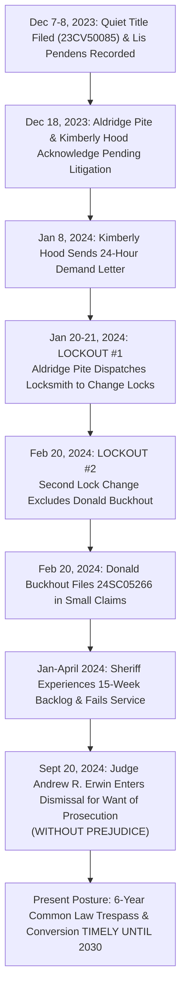

# EXTRA-JUDICIAL SELF-HELP EVICTION & OUSTER AUDIT
## Subject Property: 1730 SW 203rd Ave, Beaverton, OR 97003
**Case References:** Washington County Small Claims Case No. [`24SC05266`](file:///home/annika/google_drive_intake/intake/Court%20files/Compilations/Legal%20docs%20folder%202.txt) & Circuit Court Case No. [`23CV50085`](file:///home/annika/google_drive_intake/Dysinger_23CV50085/Case_File_23CV50085.txt)
**Target Defendants:** Aldridge Pite, LLP; Kimberly Hood; Deutsche Bank Trust Company Americas
**Injured Parties:** Donald Buckhout (Tenant in Possession); Annika Eriksson (Record Owner)

================================================================================
### SECTION I. THE ANATOMY OF AN UNLAWFUL SELF-HELP EVICTION
================================================================================

In Oregon, the Forcible Entry and Wrongful Detainer (FED) statutes (ORS 105.105 – 105.168) and the Oregon Residential Landlord and Tenant Act (ORS Chapter 90) provide the **exclusive judicial mechanism** for obtaining possession of residential premises. 

A purchaser at a sheriff’s sale or mortgage loan servicer is strictly prohibited from engaging in extra-judicial self-help, changing locks, shutting off utilities, or excluding occupants without:
1. Filing an FED complaint in circuit court;
2. Serving a statutory summons and notice of restitution;
3. Obtaining a final judgment of restitution; and
4. Having the **County Sheriff** execute a formal Writ of Execution of Restitution (Writ of Assistance).

Aldridge Pite, LLP and attorney Kimberly Hood knowingly bypassed the entire judicial process:

***
#### 1. Pre-Lockout Notice of Litigation (December 2023 – January 2024)
* **December 8, 2023:** Annika Eriksson records a formal **Lis Pendens** in Washington County Deed Records, providing statutory constructive notice of pending title litigation.
* **December 18, 2023:** Aldridge Pite, LLP and Kimberly Hood communicate with Annika and Donald Buckhout, explicitly acknowledging the existence of the pending quiet title lawsuit (`23CV50085`).
* **January 8, 2024:** Despite knowing title and possession were actively contested in circuit court, Kimberly Hood serves an aggressive demand for a 24-hour response, threatening physical takeover.

***
#### 2. Lockout #1: The January 20–21, 2024 Break-In & Lock Change
* **The Extra-Judicial Raid:** Over the weekend of January 20–21, 2024, agents dispatched by Aldridge Pite, LLP and Kimberly Hood arrived at 1730 SW 203rd Ave.
* **Absence of Writ:** No Sheriff was present. No Writ of Assistance was issued. No eviction action was filed.
* **The Lockout:** The agents removed the existing deadbolts, installed new contractor lockboxes and padlocks, and posted deceptive notices asserting property ownership.
* **Occupant Impact:** Donald Buckhout, who resided at the property as a lawful bona fide tenant, was locked out of his home in the dead of winter. Both Donald’s and Annika’s personal property, legal evidence, computers, clothing, and essential documents were seized behind locked doors.

***
#### 3. Lockout #2: The February 20, 2024 Second Exclusion
* **Re-Entry & Escalation:** Following efforts by the occupants to regain lawful access, Aldridge Pite and Kimberly Hood dispatched a second lock-changing crew on or about **February 20, 2024**.
* **Total Deprivation:** The locks were changed a second time, completely ousting Donald Buckhout from the residence, severing utility continuity, and causing severe, irreparable disruption to Annika’s litigation records.

***
#### 4. Donald Buckhout’s Small Claims Suit: Case No. `24SC05266`
* **Filing Date:** February 20, 2024 (the exact date of the second lockout).
* **Parties:** *Donald Buckhout v. Aldridge Pite, LLP and Kimberly Hood*.
* **Damages Sought:** Compensatory damages for unlawful exclusion, lockouts, destruction of personal property, and tortious interference.
* **Fee Waiver Granted:** On February 20, 2024, the court granted Donald’s fee deferral/waiver application ($102.00).

***
#### 5. The State Action Bottleneck: The 15-Week Sheriff Service Backlog
* **Attempted Service:** Donald promptly requested service of the summons and claim through the Sheriff's Office.
* **Official Sheriff Notice of Backlog:** On January 22, 2024, the **Multnomah County Sheriff's Office (MCSO Civil Process Unit)**, via Civil Unit Clerk Nora Wiedrich and Sheriff Nicole Morrisey O'Donnell, officially notified Annika and Donald:
  > *"Multnomah County Sheriff's Office Civil Process Unit is currently experiencing an extensive backlog of over 15 weeks for new service requests..."*
* **Postponement Granted:** On April 24, 2024, the Washington County Court granted an administrative Rule 7 Service Postponement recognizing the service delay.
* **The Dismissal:** Despite the documented state action delay beyond Donald’s control, the Sheriff failed to complete personal service on Aldridge Pite or Kimberly Hood within the extended period.
* **September 20, 2024:** Washington County Circuit Court **Judge Andrew R. Erwin** entered a `Judgment - General Dismissal` dismissing Case No. `24SC05266`.

================================================================================
### SECTION II. THE PROCEDURAL & PRECLUSION AUDIT
================================================================================

1. **The Dismissal Was WITHOUT PREJUDICE as a Matter of Law:**
   * Under Oregon Rules of Civil Procedure (ORCP 54 B(1) and ORCP 54 B(4)), any dismissal for failure to serve, failure to prosecute, or administrative docket clearing is **without prejudice** unless expressly stated otherwise.
   * Under small claims procedures, a case closed before hearing or service has zero preclusive effect on the underlying merits.
2. **Aldridge Pite & Kimberly Hood Were Not Landlords:**
   * In `24SC05266`, Donald filed on standard small claims forms citing unlawful ouster concepts.
   * While the Residential Landlord and Tenant Act (ORS 90.375) governs disputes between landlords and tenants, Aldridge Pite, LLP and Kimberly Hood were **third-party law firms and tortfeasors**.
   * Under Oregon common law, a third party who enters land in the possession of another and forcibly excludes the lawful occupant commits **Common Law Trespass to Land** (*Hansen v. O'Reilly*, 118 Or 518) and **Conversion of Chattels** (*Mustola v. Toddy*, 253 Or 658).
3. **The 6-Year Limitations Safeguard (ORS 12.080):**
   * While the specialized 1-year Landlord-Tenant Act limitation (ORS 12.125) and its 180-day savings extension (ORS 12.220) have elapsed, **common law trespass and conversion carry a SIX-YEAR statute of limitations** under ORS 12.080(3) and ORS 12.080(4).
   * **Donald Buckhout and Annika Eriksson have until FEBRUARY 2030 to sue Aldridge Pite, LLP and Kimberly Hood in Circuit Court!**

================================================================================
*Report prepared for action plan development and tort damages litigation.*
