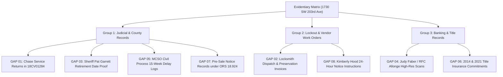

# MISSING DOCUMENTARY GAPS & SUBPOENA CHECKLIST
## Subject Property: 1730 SW 203rd Ave, Beaverton, OR 97003
**Litigation Targets:** Deutsche Bank Trust Company Americas; Aldridge Pite, LLP; Kimberly Hood; Washington County Sheriff
**Purpose:** Strategic Discovery Checklist for Action Plan Development & Evidentiary Ingestion

================================================================================
### SECTION I. EXECUTIVE SUMMARY OF EVIDENTIARY GAPS
================================================================================

While the existing record establishes a compelling prima facie case of void judgment, unconstitutional self-help eviction, and common law trespass, specific documentary links must be retrieved from court archives, county records, or compelled via subpoena duces tecum to complete the evidentiary matrix.

================================================================================
### SECTION II. ITEMIZED AUDIT OF MISSING DOCUMENTARY GAPS
================================================================================

***
#### GAP 01: Proof of Nonjoinder & Lack of Service on JPMorgan Chase Bank in `18CV01284`
* **Status:** **CRITICAL GAP (High Priority)**
* **Description:** Certified copy of the complete Summons, Return of Service, and Certificate of Service filed in Washington County Circuit Court Case No. `18CV01284`.
* **Legal Significance:** Under Oregon law, a judgment rescinding a recorded deed of reconveyance is void *ab initio* if the beneficiary of the reconveyance (JPMorgan Chase Bank) was not joined as an indispensable party. Demonstrating from the court docket that no summons was ever issued to or served on JPMorgan Chase Bank confirms the voidness of the 2018 Foreclosure Judgment.
* **Target Custodian:** Washington County Circuit Court Records Department (Odyssey Case File for `18CV01284`).
* **Retrieval Method:** Certified microfiche/electronic file request for Case No. `18CV01284`.

***
#### GAP 02: Locksmith Work Orders, Dispatch Logs & Contractor Invoices (Jan & Feb 2024 Lockouts)
* **Status:** **CRITICAL GAP (Immediate Subpoena Target)**
* **Description:** The internal work order, purchase order, locksmith dispatch log, and payment invoice issued by Aldridge Pite, LLP, Kimberly Hood, or Deutsche Bank's loan servicer (PHH Mortgage / NewRez) for changing the locks at 1730 SW 203rd Ave on:
  1. January 20–21, 2024 (Lockout #1); and
  2. February 20, 2024 (Lockout #2).
* **Legal Significance:** Establishes direct civil tort liability for common law trespass to real property (ORS 12.080(3)) and conversion of personal property (ORS 12.080(4)). Identifies the exact vendor, property preservation company (e.g., Cyprexx, Safeguard, MCS), and individuals who broke into the premises.
* **Target Custodian:** Aldridge Pite, LLP (Managing Partner & Records Custodian) and Kimberly Hood.
* **Retrieval Method:** Subpoena duces tecum in circuit court tort action; formal discovery request.

***
#### GAP 03: Washington County Sheriff Personnel Records (Pat Garrett Retirement Date)
* **Status:** **ESSENTIAL GAP (Facial Deed Challenge)**
* **Description:** Certified public record establishing the exact effective date of retirement or resignation of Sheriff Pat Garrett from the Washington County Sheriff's Office.
* **Legal Significance:** The Sheriff’s Deed recorded on December 19, 2023 (Instrument No. 2023-066922) names *"Pat Garrett, Sheriff of Washington County, Oregon"* as grantor. Demonstrating that Pat Garrett had retired prior to December 14, 2023 proves the deed is facially defective and invalid to pass title under ORS 18.942.
* **Target Custodian:** Washington County Board of County Commissioners, Human Resources, or Oregon Department of Public Safety Standards and Training (DPSST).
* **Retrieval Method:** Oregon Public Records Request (ORS 192.311 et seq.).

***
#### GAP 04: High-Resolution Scans of Promissory Note Endorsements (2016 vs. 2018 Actions)
* **Status:** **SUBSTANTIVE GAP (Standing Nullity)**
* **Description:** Certified color scans of the Promissory Note and Allonges presented in the dismissed 2016 foreclosure action compared directly against the Note and Allonges filed in `18CV01284`.
* **Legal Significance:** Proves that the special endorsement from Judy Faber (Residential Funding Company) was manufactured and appended years after the 2007 closing date of the RALI 2006-QS14 trust and after Millennia Mortgage was dissolved in Oregon in 2009.
* **Target Custodian:** Washington County Circuit Court clerk (exhibits in `18CV01284`); Deutsche Bank collateral files.
* **Retrieval Method:** Motion to Inspect Original Commercial Paper; Subpoena to Document Custodian.

***
#### GAP 05: Multnomah County Sheriff's Office Civil Process Backlog Logs (`24SC05266`)
* **Status:** **SUPPORTING GAP (State Action Causation)**
* **Description:** Official intake receipts, dispatch tracking logs, and certified administrative memoranda from the Multnomah County Sheriff's Office (MCSO Civil Process Unit) regarding the small claims summons issued in Case No. `24SC05266` (*Donald Buckhout v. Aldridge Pite, LLP and Kimberly Hood*).
* **Legal Significance:** Conclusively proves that the failure of service in `24SC05266` was caused entirely by a state-acknowledged 15-week systemic administrative backlog, rebutting any claim that Donald Buckhout failed to prosecute diligently.
* **Target Custodian:** Multnomah County Sheriff's Office, Civil Process Unit (2955 NE 172nd Pl, Portland, OR 97230).
* **Retrieval Method:** Oregon Public Records Request to MCSO Civil Records.

***
#### GAP 06: Title Insurance Commitments & Policies (2014 & 2021 Conveyances)
* **Status:** **SUPPORTING GAP (Bona Fide Purchaser Proof)**
* **Description:** Complete title insurance commitment, preliminary title reports, and policy jackets issued by Lawyer's Title / First American Title for:
  1. Turning Leaf Homes, LLC’s purchase on October 16, 2014 (Deed No. 2014-073078); and
  2. Annika Eriksson’s purchase on December 20, 2021 (Deed No. 2021-130007).
* **Legal Significance:** Establishes that certified title examiners confirmed that the 2014 Chase Reconveyance cleared the 2006 Millennia Deed of Trust, proving that both Turning Leaf Homes and Annika Eriksson acquired title as bona fide purchasers without encumbrance.
* **Target Custodian:** Lawyer’s Title Oregon / Fidelity National Title Group.
* **Retrieval Method:** Policy retrieval request / Subpoena to Title Underwriter.

***
#### GAP 07: Proof of Statutory Certified Mail Pre-Sale Notice (ORS 18.924 / ORS 18.926)
* **Status:** **STATUTORY GAP (Sheriff's Sale Irregularity)**
* **Description:** The Washington County Sheriff’s complete pre-sale certified mail dispatch logs, return green cards, and mailing affidavits for the June 8, 2023 Sheriff’s auction in Case No. `18CV01284`.
* **Legal Significance:** Under ORS 18.924(2) and ORS 18.926, the sheriff must send notice of sale by certified mail to all persons holding recorded interests. Failure to strictly comply with statutory notice requirements invalidates the sheriff's sale.
* **Target Custodian:** Washington County Sheriff’s Office Civil Process Unit.
* **Retrieval Method:** Public records inspection of Sheriff's Sale File for Case No. `18CV01284`.

================================================================================
### SECTION III. SUMMARY DISCOVERY ROADMAP
================================================================================

| Gap ID | Target Document | Primary Custodian | Purpose in Action Plan |
| :--- | :--- | :--- | :--- |
| **GAP 01** | Chase Nonjoinder Certificate | Washington County Court Clerk | Confirms voidness of 2018 Judgment |
| **GAP 02** | Locksmith Work Orders & Invoices | Aldridge Pite / Kimberly Hood | Proves intentional trespass & conversion |
| **GAP 03** | Pat Garrett Retirement Records | Washington County Commissioners/HR | Proves facially void Sheriff's Deed |
| **GAP 04** | 2016 vs 2018 Note Endorsements | Court Exhibit Archives / DB Vault | Establishes forged/manufactured standing |
| **GAP 05** | MCSO 15-Week Backlog Logs | Multnomah County Sheriff's Office | Rebuts neglect; proves state delay |
| **GAP 06** | 2014 & 2021 Title Policies | Lawyer's Title / Fidelity | Proves Bona Fide Purchaser status |
| **GAP 07** | Pre-Sale Certified Mail Green Cards | Washington County Sheriff | Proves ORS 18.924 notice violations |

================================================================================
*Checklist finalized for immediate deployment in litigation and public records requests.*
