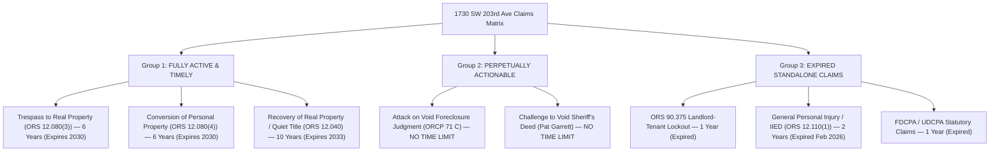
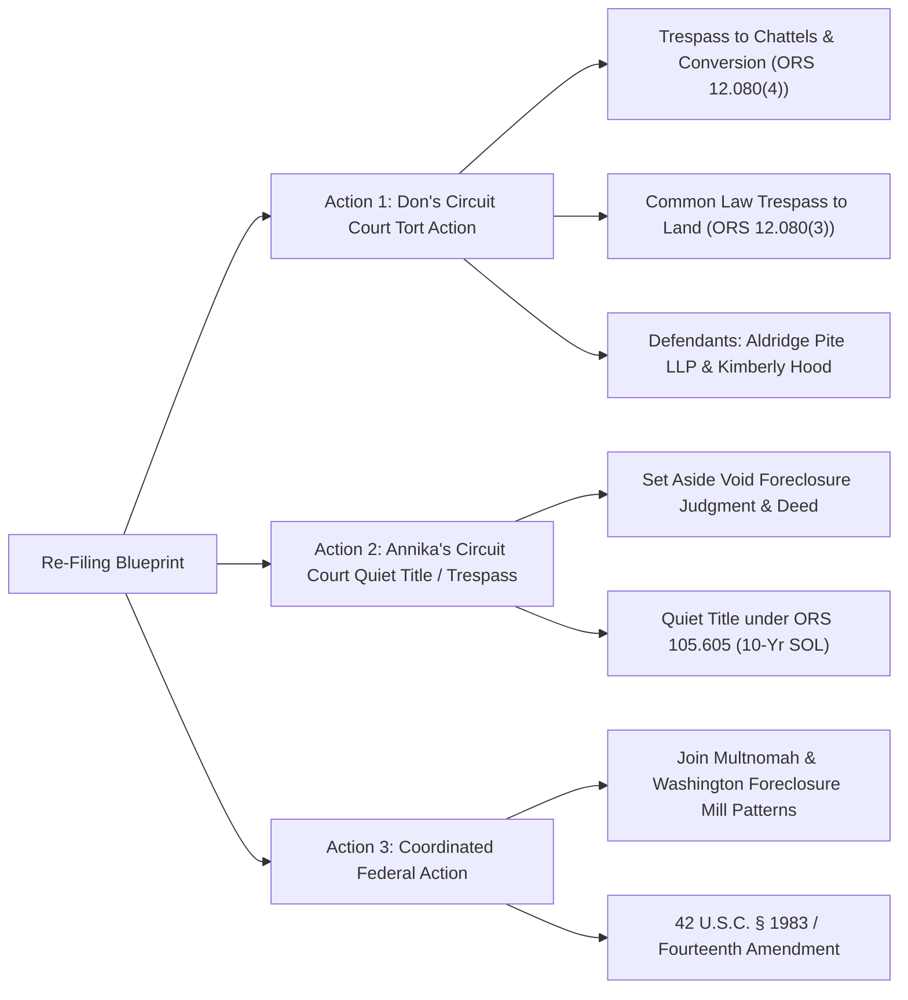

# FORENSIC AUDIT & STATUTE OF LIMITATIONS (SOL) ANALYSIS
## Washington County Quiet Title (`23CV50085`), Small Claims Ouster (`24SC05266`), and Appellate Trajectory (`A184800`)
**Subject Property:** 1730 SW 203rd Ave, Beaverton, OR 97003
**Audited Parties:** Annika Eriksson, Donald Buckhout, Aldridge Pite, LLP, Kimberly Hood, Deutsche Bank Trust Company Americas (RALI 2006-QS14)
**Analysis Date:** October 22, 2026

================================================================================
### SECTION I. PROCEDURAL AUDIT & CASE ANATOMY
================================================================================

This audit examines the three interconnected proceedings arising from the attempted seizure and self-help lockout of **1730 SW 203rd Ave, Beaverton, OR 97003**:

#### 1. The Quiet Title Action: Washington County Case No. [`23CV50085`](file:///home/annika/google_drive_intake/Dysinger_23CV50085/Case_File_23CV50085.txt)
* **Filing Date:** December 7, 2023.
* **Lis Pendens:** Recorded December 8, 2023 in Washington County Deed Records.
* **Plaintiff:** Annika Eriksson (Pro Se).
* **Defendants:** Deutsche Bank Trust Company Americas as Trustee for Residential Accredit Loans, Inc., Mortgage Asset-Backed Pass-Through Certificates Series 2006-QS14; Shadow Wood Homeowners Association; Oregon DOJ - Division of Child Support; Turning Leaf Homes, LLC; Accounts Receivable, Inc.; JP Morgan Chase Bank; Agustina L. Monckton; Gerald G. Monckton, Jr.; and MERS.
* **Title & Possession Chain:**
  * Annika acquired fee simple title from Turning Leaf Homes, LLC via deed recorded on December 20, 2021 (Document No. `2021-130007`).
  * Turning Leaf Homes, LLC acquired title via a bankruptcy-court-approved sale in 2014 in the Monckton Chapter 13 case (`11-37599` / `12-12020`).
  * In 2014, a formal document of reconveyance executed by MERS and Chase was recorded, removing the 2006 first mortgage lien from the property.
  * In 2018, Deutsche Bank filed a judicial foreclosure action (Washington County Case No. `18CV01284`) seeking to rescind Chase's reconveyance **without naming or serving JPMorgan Chase Bank**.
  * A Sheriff’s auction was conducted on June 8, 2023, and a Sheriff's Deed was recorded on December 19, 2023 invoking retired Sheriff Pat Garrett.
  * Annika and her bona fide tenant, Donald Buckhout, maintained actual physical possession of the property when `23CV50085` was filed and lis pendens recorded.
* **The Dismissal:**
  * On March 14, 2024, Deutsche Bank (via Joseph T. McCormick III of Wright, Finlay & Zak / Aldridge Pite) moved to dismiss under ORCP 21 A, arguing Annika was not in possession (a condition Deutsche Bank engineered through extra-judicial lockouts).
  * A motion hearing was calendared for May 13, 2024 at 9:30 AM before **Judge Erik Buchér** in Courtroom 304C.
  * Annika was unable to attend because her driver (Casey Conant) overslept. The hearing lasted less than 3 minutes (9:33:06 AM – 9:36:18 AM). Judge Buchér summarily granted Deutsche Bank's motion to dismiss with prejudice.
  * Annika timely filed a Motion to Set Aside Dismissal under ORCP 71 B(1) on May 20, 2024 supported by declarations from Annika and Casey Conant. Judge Buchér denied the motion on May 28, 2024, and denied reconsideration on June 3, 2024.
  * Limited Judgment of Dismissal was entered June 4, 2024.

#### 2. The Illegal Lockouts & Small Claims Action: Case No. `24SC05266`
* **The Extra-Judicial Lockouts:**
  * **December 18, 2023:** Aldridge Pite, LLP and attorney **Kimberly Hood** formally acknowledged the pending quiet title lawsuit and recorded lis pendens.
  * **January 8, 2024:** Aldridge Pite issued a demand for a 24-hour response.
  * **January 20–21, 2024 (Lockout #1):** Aldridge Pite and Kimberly Hood, acting on behalf of Deutsche Bank, dispatched agents/locksmiths to 1730 SW 203rd Ave and changed the locks without an eviction action (FED), without a writ of assistance, and without judicial process, locking out lawful tenant Donald Buckhout and locking up personal property and legal records.
  * **February 20, 2024 (Lockout #2):** Aldridge Pite and Kimberly Hood executed a second lock change, completely excluding the occupants from their home and personal effects.
* **The Small Claims Lawsuit (`24SC05266`):**
  * **Filing Date:** February 20, 2024 in Washington County Circuit Court (Small Claims Department).
  * **Title:** *Donald Buckhout v. Aldridge Pite, LLP and Kimberly Hood*.
  * **Claims:** Unlawful ouster / exclusion under ORS 90.375, common law trespass, conversion of personal property, and tortious interference.
  * **The Service Backlog:** Don requested service through the Sheriff's Office. On January 22, 2024, the Multnomah County Sheriff's Office (MCSO Civil Process Unit) formally notified the parties that it was experiencing an **extensive backlog of over 15 weeks** for civil process service.
  * A Rule 7 service postponement was granted by the court on April 24, 2024.
  * **Dismissal for Want of Prosecution:** On September 20, 2024, **Judge Andrew R. Erwin** entered a `Judgment - General Dismissal` dismissing `24SC05266` for lack of completed service / want of prosecution.

#### 3. The Appellate Trajectory: Oregon Court of Appeals No. `A184800`
* **Notice of Appeal:** Filed July 5, 2024 by Annika Eriksson from the June 4, 2024 Limited Judgment of Dismissal.
* **Show Cause & Correction:** On September 19, 2024, Appellate Commissioner Theresa Kidd issued an Order to Show Cause regarding service of the notice of appeal on counsel vs. party.
* Annika responded on October 31, 2024 and filed a formal Motion for Leave to File Late Notice of Appeal on November 29, 2024, establishing excusable neglect under Pioneer factors, technological e-filing hurdles, and severe medical incapacitation (hospitalization at Kaiser Sunnyside from May 20–23, 2024 for severe kidney infection with suspected sepsis).

================================================================================
### SECTION II. LEGAL EFFECT OF THE SMALL CLAIMS DISMISSAL
================================================================================

Donald Buckhout's small claims case (`24SC05266`) was dismissed on September 20, 2024 by Judge Andrew R. Erwin because the Sheriff took too long to effect service.

**CRITICAL PROCEDURAL RULING:**
1. **The Dismissal Was WITHOUT PREJUDICE:**
   * Under Oregon law (ORCP 54 B(1) and ORCP 54 B(4)), any dismissal for failure to serve, failure to prosecute, or administrative clean-up is **without prejudice** unless the judgment explicitly states "with prejudice."
   * Small claims dismissals prior to hearing or appearance are non-merit dismissals for lack of jurisdiction over the unserved defendants.
2. **No Claim Preclusion (Res Judicata):**
   * A dismissal without prejudice does **not** adjudicate the merits. It places the parties in the exact position as if the suit had never been brought.
   * Neither Donald Buckhout nor Annika Eriksson is barred by claim preclusion or issue preclusion from re-asserting their claims against Aldridge Pite, LLP, Kimberly Hood, or Deutsche Bank.
3. **The Sole Hurdle is the Statute of Limitations (SOL):**
   * Because the dismissal was without prejudice, the only legal barrier to refiling is whether the applicable Statute of Limitations has expired as of today (October 22, 2026).

================================================================================
### SECTION III. COMPREHENSIVE STATUTE OF LIMITATIONS (SOL) AUDIT
================================================================================

The following matrix audits every potential legal claim arising from the lockouts, property destruction, and title usurpation at 1730 SW 203rd Ave, evaluated as of **October 22, 2026**:

***
#### 1. CLAIMS FULLY ACTIVE AND TIMELY (6-YEAR & 10-YEAR STATUTES)

##### A. Trespass to Real Property — ORS 12.080(3) (6-YEAR SOL)
* **Governing Statute:** ORS 12.080(3) provides:
  > *"An action for trespass upon or injury to real property... shall be commenced within six years."*
* **Claimants:** Both Annika Eriksson (fee owner with right of possession) and Donald Buckhout (lawful tenant in actual physical possession).
* **Defendants:** Aldridge Pite, LLP; attorney Kimberly Hood; the property preservation vendor/locksmith; and Deutsche Bank Trust Company Americas (as principal).
* **Actionable Conduct:** Entering onto real property without lawful authority, cutting or disabling locks, invading the dwelling, and locking out lawful occupants without an FED eviction judgment or writ of assistance.
* **Accrual Dates:** January 20–21, 2024 (Lockout #1) and February 20, 2024 (Lockout #2).
* **Expiration Date:** **January 21, 2030 and February 20, 2030.**
* **Current Status:** **FULLY TIMELY AND ACTIVE!** There are **over 3 years and 3 months remaining** to file this action.

##### B. Conversion / Detinue / Taking & Detaining Personal Property — ORS 12.080(4) (6-YEAR SOL)
* **Governing Statute:** ORS 12.080(4) provides:
  > *"An action for taking, detaining or injuring personal property, including an action for the specific recovery thereof... shall be commenced within six years."*
* **Claimants:** Donald Buckhout and Annika Eriksson.
* **Defendants:** Aldridge Pite, LLP; Kimberly Hood; and Deutsche Bank.
* **Actionable Conduct:** Seizing, locking inside, denying access to, damaging, or throwing away Don’s and Annika’s personal possessions, furniture, tools, household items, computers, and irreplaceable legal records.
* **Accrual Dates:** January/February 2024.
* **Expiration Date:** **January/February 2030.**
* **Current Status:** **FULLY TIMELY AND ACTIVE!** Over 3 years remain to sue for full compensatory and punitive damages for every item of personal property converted or detained.

##### C. Recovery of Real Property & Determination of Adverse Claims (Quiet Title) — ORS 12.040(1) & ORS 105.605 (10-YEAR SOL)
* **Governing Statute:** ORS 12.040(1) provides:
  > *"An action for the recovery of real property, or for the recovery of the possession thereof, shall be commenced within 10 years."*
* **Claimant:** Annika Eriksson.
* **Defendant:** Deutsche Bank Trust Company Americas.
* **Actionable Conduct:** Wrongful assertion of ownership based on an unconstitutional foreclosure judgment and invalid Sheriff’s Deed clouding Annika's record title.
* **Accrual Date:** December 19, 2023 (recording of Sheriff’s Deed).
* **Expiration Date:** **December 19, 2033.**
* **Current Status:** **FULLY TIMELY AND ACTIVE!** Over 7 years remain on the real property recovery limitation period.

***
#### 2. CLAIMS SUBJECT TO NO STATUTE OF LIMITATIONS AT ALL (PERPETUALLY ACTIONABLE)

##### Attack on Void Judgment & Void Sheriff's Deed (ORCP 71 C & Oregon Common Law)
Under established Oregon Supreme Court jurisprudence (*Hughes v. Aetna Cas. & Sur. Co.*, 234 Or 426, 434 (1963); *Burt & Gordon v. Stein*, 128 Or App 350, 354 (1994); *Bailey v. Vanderkin*, 198 Or App 232 (2005)):
> A judgment that is void for lack of subject-matter jurisdiction or failure to join an indispensable party is a complete legal nullity. It confers no rights, creates no title, and **may be attacked directly or collaterally AT ANY TIME**.

The 2018 Foreclosure Judgment (`18CV01284`) and the 2023 Sheriff's Deed are void *ab initio* for three independent structural reasons:
1. **Omission of Indispensable Party (JPMorgan Chase Bank):**
   * Deutsche Bank sued to judicially rescind a recorded 2014 document of reconveyance executed by MERS and Chase that had cleared the mortgage lien.
   * Deutsche Bank intentionally failed to name or serve JPMorgan Chase Bank.
   * Under Oregon law and the Fourteenth Amendment, rescinding a recorded property instrument without joining the beneficiary/trustee deprives the court of subject-matter jurisdiction to extinguish that interest.
2. **Sheriff’s Deed Void on its Face (Retired Sheriff Pat Garrett):**
   * The Sheriff’s Deed recorded on December 19, 2023 explicitly states on its face that it was issued by *"Pat Garrett, Sheriff of Washington County, Oregon."*
   * Pat Garrett had retired prior to the date of execution!
   * An official deed executed in the name of a person who no longer holds lawful office is ultra vires and legally incapable of transferring title.
3. **Standing & Negotiation Defects:**
   * The promissory note endorsement was signed by Judy Faber of Residential Funding Company, who has admitted under oath in nationwide litigation that she had no personal knowledge of transactions she endorsed.
   * The endorsement occurred years after the 2007 closing date of the RALI 2006-QS14 trust and after Millennia Mortgage's authority to do business in Oregon was formally revoked in 2009.
* **Statute of Limitations:** **NONE.** A void judgment or deed can be moved against under ORCP 71 C or challenged in any subsequent quiet title action without any time limit.

***
#### 3. CLAIMS WHERE STANDALONE STATUTORY LIMITATIONS HAVE RUN

##### A. ORS 90.375 (Residential Landlord and Tenant Act Unlawful Ouster)
* **Governing Statute:** ORS 12.125 sets a strict **one-year** limitations period for actions arising under ORS Chapter 90.
* **The Savings Statute (ORS 12.220):**
  * Don filed `24SC05266` within 1 month (Feb 20, 2024).
  * The dismissal occurred September 20, 2024.
  * Under ORS 12.220, a dismissal without prejudice extends the deadline to refile for **180 days** (which expired on March 19, 2025).
  * Consequently, the specific statutory penalty under ORS 90.375 (two months' rent or twice actual damages) can no longer be brought under Chapter 90.
  * **CRITICAL TAKEAWAY:** Don’t need Chapter 90! Aldridge Pite and Kimberly Hood were **never Don's landlord**—they were third-party tortfeasors! Therefore, the 6-year statutes for **trespass** (ORS 12.080(3)) and **conversion** (ORS 12.080(4)) control and remain wide open!

##### B. General Personal Injury / IIED — ORS 12.110(1) (2-YEAR SOL)
* Standalone common law claims for personal injury, negligence, and Intentional Infliction of Emotional Distress (IIED) have a 2-year limitation period.
* Two years from January/February 2024 expired in January/February 2026 (approximately 8 months ago).
* *Note:* Emotional distress damages directly flowing from **trespass to land** or **conversion of property** can still be recovered as consequential damages within the 6-year claims under ORS 12.080!

##### C. Federal FDCPA (15 U.S.C. § 1692k(d)) & Oregon UDCPA (ORS 646.641(3))
* Both statutes have a 1-year statute of limitations running from the date of the violation. Standalone statutory debt collection claims for the 2024 lockouts have expired.

================================================================================
### SECTION IV. THE STRATEGIC RE-FILING BLUEPRINT FOR DON & ANNIKA
================================================================================

Because Don’s small claims action was dismissed for lack of service (want of prosecution), and Annika’s quiet title dismissal was a limited dismissal with prejudice rendered in 3 minutes during an excusable transportation emergency, Don and Annika possess an exceptionally strong posture to re-assert their rights:

#### 1. Don Buckhout's Action against Aldridge Pite, LLP & Kimberly Hood
* **Forum:** Washington County Circuit Court (Civil Department, not Small Claims, to seek full actual and punitive damages).
* **Causes of Action:**
  1. **Common Law Trespass to Real Property (ORS 12.080(3)):** As a lawful tenant in peaceable possession, Don has direct standing to sue third-party intruders for unlawful entry and lock changing.
  2. **Conversion of Personal Property (ORS 12.080(4)):** Seeking full market value and loss of use for all personal belongings, documents, and tools locked inside or destroyed.
  3. **Consequential Damages:** Including housing disruption, alternative living costs, and consequential distress resulting directly from the trespass.
* **Why this overcomes the prior dismissal:** It is brought well within the 6-year SOL (expires 2030), avoids the expired 1-year Landlord-Tenant Act limit, and directly targets the tortious actors (Aldridge Pite, LLP and Kimberly Hood) who engaged in unlawful extra-judicial self-help.

#### 2. Annika Eriksson's Quiet Title & Property Action
* **Pending Appeal (`A184800`):**
  * The appeal from Judge Buchér's June 4, 2024 limited judgment remains viable based on:
    (a) The 3-minute dismissal with prejudice on excusable neglect grounds under ORCP 71 B(1);
    (b) The fact that Deutsche Bank created the very lack of possession it relied upon to move for dismissal; and
    (c) The fatal voidness of the 2018 judgment for nonjoinder of Chase.
* **Alternative New Circuit Court Action:**
  * Even if the appeal were discontinued or concluded, Annika has until **December 19, 2033** (the 10-year period under ORS 12.040) to bring an independent action for recovery of real property and quiet title under ORS 105.605, joined with claims for common law trespass (ORS 12.080(3)) against Aldridge Pite and Deutsche Bank.

================================================================================
### SECTION V. SUMMARY MATRIX OF TIMELINESS
================================================================================

| Claim Description | Applicable Statute | Governing SOL | Accrual Date | Expiration Date | Status as of Oct 22, 2026 |
| :--- | :--- | :--- | :--- | :--- | :--- |
| **Trespass to Real Property** | ORS 12.080(3) | **6 Years** | Jan/Feb 2024 | **Jan/Feb 2030** | **ACTIVE (3+ Yrs Left)** |
| **Conversion of Personal Property** | ORS 12.080(4) | **6 Years** | Jan/Feb 2024 | **Jan/Feb 2030** | **ACTIVE (3+ Yrs Left)** |
| **Recovery of Real Property (Quiet Title)** | ORS 12.040(1) | **10 Years** | Dec 19, 2023 | **Dec 19, 2033** | **ACTIVE (7+ Yrs Left)** |
| **Attack on Void Judgment / Pat Garrett Deed** | ORCP 71 C | **NO LIMIT** | Dec 17, 2018 | **NEVER EXPIRES** | **PERPETUALLY TIMELY** |
| General Personal Injury / IIED | ORS 12.110(1) | 2 Years | Jan/Feb 2024 | Jan/Feb 2026 | Expired (Consequential only) |
| ORS 90.375 Tenant Lockout Penalty | ORS 12.125 | 1 Year | Jan/Feb 2024 | Jan/Feb 2025 | Expired (Use Trespass instead) |
| FDCPA / UDCPA Debt Collection | 15 U.S.C. § 1692k | 1 Year | Jan/Feb 2024 | Jan/Feb 2025 | Expired |

================================================================================
*Audit complete. Donald Buckhout and Annika Eriksson remain fully empowered under Oregon law to prosecute Aldridge Pite, LLP, Kimberly Hood, and Deutsche Bank for common law trespass, conversion, and quiet title until 2030–2033.*
